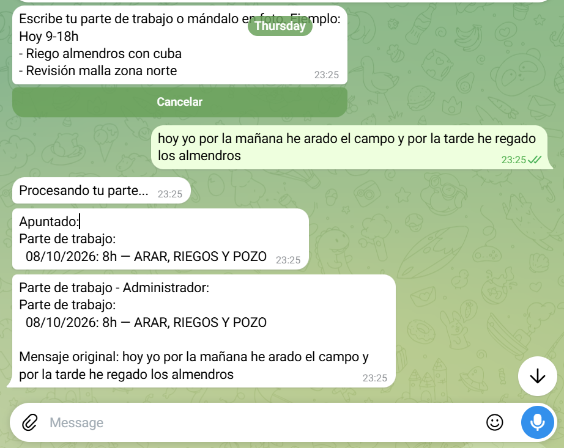
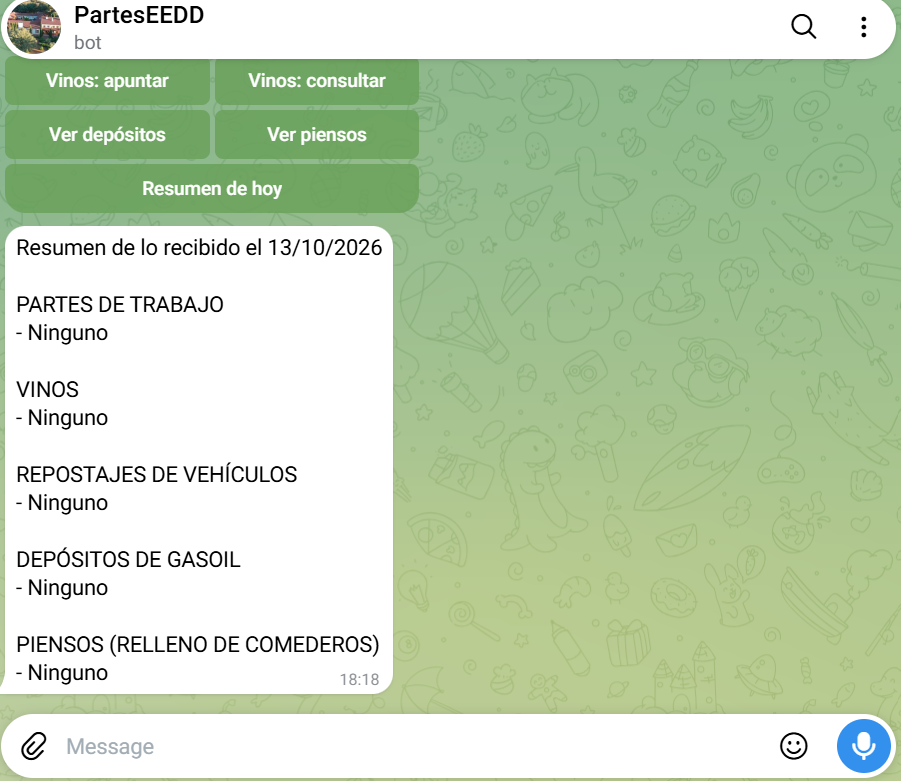

# Bot de la finca: partes de trabajo, gasoil, piensos y vinos

Bot de Telegram para una finca de caza. El equipo escribe en lenguaje natural (o manda una foto del parte), un LLM extrae los datos y el bot los guarda en un único Google Sheet con fórmulas. La secretaria recibe un aviso de todo lo que se apunta.

Pensado para personas con poca soltura tecnológica: no hay formularios ni comandos obligatorios, solo escribir como en WhatsApp.

| Menú | Parte de trabajo | Resumen del día |
|---|---|---|
|  |  |  |

## Qué hace

- **Partes de trabajo**: texto o foto del parte en papel; extrae fecha, horas, categoría y trabajador.
- **Vehículos**: repostajes con litros y kilómetros; consumo calculado de lleno a lleno.
- **Depósitos de gasoil**: lecturas y entradas, con último nivel y seguimiento.
- **Piensos**: rellenos semanales de comederos y consumo por comedero.
- **Vinos**: entradas y salidas con stock calculado (solo usuarios autorizados).
- **Resumen y avisos**: la secretaria recibe cada registro y puede pedir el resumen del día.

## Flujo

1. La persona escribe o manda una foto.
2. El LLM devuelve datos estructurados y el código los valida (fechas, unidades, categorías oficiales, coincidencia aproximada de nombres).
3. El bot muestra una **ficha** con lo entendido y botones Sí/No. Hasta pulsar Sí no se escribe nada.
4. Si el bot detecta algo fuera de lo normal, lo registra igualmente y rellena la columna **Revisar** (fila en rojo) para que se compruebe después.
5. Corregir es editar o borrar la fila en el Sheet; no hay estados ni «deshacer».

## Tecnología

- Python 3.14, `python-telegram-bot` 21 (polling)
- Groq: `openai/gpt-oss-120b` (texto) y `qwen/qwen3.8-27b` (visión), configurables por variables de entorno
- Google Sheets con `gspread`; el stock, el consumo y los paneles son fórmulas del propio Sheet
- Control de cuota de la API de Sheets (reintentos con espera y caché)
- Zona horaria Europe/Madrid

## Estructura

| Archivo | Función |
|---|---|
| `bot.py` | Telegram: menú, fichas, permisos y avisos |
| `extractor.py` | Prompts al LLM y validación de lo que devuelve |
| `sheets.py` | Conexión a Google Sheets y partes de trabajo |
| `vinos.py`, `gasoil.py`, `piensos.py` | Lógica y hojas de cada área |
| `estilo_sheet.py` | Formato del Sheet (idempotente) |
| `auditoria.py` | Revisión de solo lectura de los datos |
| `workers.py` | Usuarios y permisos (datos de ejemplo) |

## Puesta en marcha

```bash
pip install -r requirements.txt
cp .env.example .env     # rellena token, clave de Groq y datos de Google
python bot.py
```

Para ejecutarlo en la nube (por ejemplo Railway) se usa el `Procfile` y la variable `GOOGLE_SERVICE_ACCOUNT_JSON`.

`workers.py` lleva IDs de ejemplo. Los reales van en `workers_local.py`, que no se sube al repositorio.
